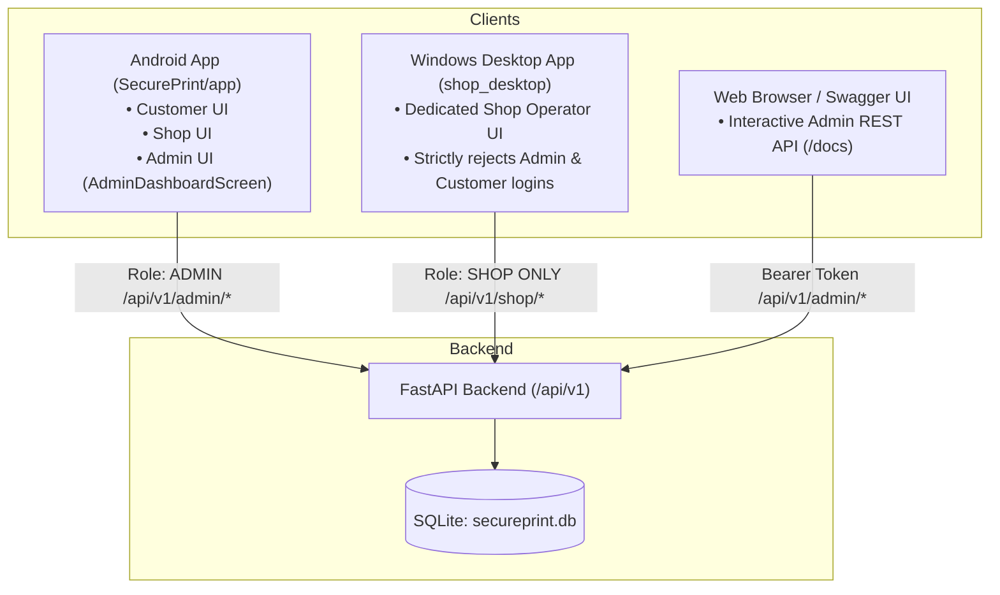

# SecurePrint Admin Shop Approval Discovery Report

**Investigation Status:** COMPLETE  
**Execution Mode:** Read-Only Audit (No code or database modifications performed)  
**Date:** October 13, 2026  

---

## Executive Summary

When a new Xerox shop owner registers an account on the SecurePrint platform, the backend assigns the user and shop profile an initial status of `PENDING` and revokes the shop QR code identity until verified. Upon subsequent login attempts, the backend returns HTTP 403 (`Account pending approval`), and the Windows Shop Desktop client surfaces the message: *"Notice: New shop accounts require administrator verification before activation."*

The Windows Shop application (`shop_desktop`) has **no visible Shop Approvals menu** because it is **intentionally architected and restricted exclusively to shop operators**. It explicitly rejects administrator logins with `Access Denied. Shop accounts only.`.

The **Administrator Interface** already exists and is fully implemented in the **Android mobile application (`SecurePrint/app`)** via Jetpack Compose (`AdminDashboardScreen`). Furthermore, the backend exposes **REST API endpoints** that can be accessed immediately via the interactive **Swagger UI (`/docs`)** or HTTP requests to approve pending shops.

---

## 1. Where the Admin Interface is Implemented

The SecurePrint ecosystem divides role responsibilities across client applications:



### Discovery Findings
1. **Android Client (`SecurePrint/app`)**:
   - The primary graphical Administrator interface is built into the Android application using Kotlin and Jetpack Compose.
   - It provides full role selection (`Customer`, `Xerox Shop`, and `Admin`), a dedicated Admin login screen, a pending shop approval dashboard, and platform-wide print job monitoring.
2. **FastAPI Interactive API Documentation (`Swagger UI / ReDoc`)**:
   - Accessible in any web browser at `http://127.0.0.1:8000/docs` (or ReDoc at `http://127.0.0.1:8000/redoc`).
   - Serves as the web-based administrative management console supporting OAuth2 token authorization and direct execution of pending shop approval and rejection operations.
3. **Windows Shop Client (`shop_desktop`)**:
   - **No administrative interface exists.** The application is built solely for shop counter operations (viewing incoming print queues, configuring printer hardware, decrypting customer documents, and printing).

---

## 2. Which Route, Screen, or Application Provides Pending-Shop Approval

### Primary Mobile Interface (Android)

* **Application:** [`SecurePrint/app`](file:///c:/Users/sansk/OneDrive/Desktop/SecurePrint/SecurePrint/app)
* **Screen Composable:** [`AdminDashboardScreen`](file:///c:/Users/sansk/OneDrive/Desktop/SecurePrint/SecurePrint/app/src/main/java/com/example/secureprint/screens/AdminDashboardScreen.kt#L20-L69)
* **Navigation Route:** `Screen.AdminDashboard` (`"admin_dashboard"`), defined in [`AppNavigation.kt`](file:///c:/Users/sansk/OneDrive/Desktop/SecurePrint/SecurePrint/app/src/main/java/com/example/secureprint/navigation/AppNavigation.kt#L25)
* **ViewModel:** [`AdminViewModel`](file:///c:/Users/sansk/OneDrive/Desktop/SecurePrint/SecurePrint/app/src/main/java/com/example/secureprint/ui/admin/AdminViewModel.kt#L19-L67)
* **User Journey on Android:**
  1. [`WelcomeScreen`](file:///c:/Users/sansk/OneDrive/Desktop/SecurePrint/SecurePrint/app/src/main/java/com/example/secureprint/screens/WelcomeScreen.kt) &rarr; Tap **Get Started**.
  2. [`RoleSelectionScreen`](file:///c:/Users/sansk/OneDrive/Desktop/SecurePrint/SecurePrint/app/src/main/java/com/example/secureprint/screens/RoleSelectionScreen.kt#L66-L71) &rarr; Tap the **Admin** card (`⚙️ Admin - Manage the SecurePrint platform`).
  3. [`AdminLoginScreen`](file:///c:/Users/sansk/OneDrive/Desktop/SecurePrint/SecurePrint/app/src/main/java/com/example/secureprint/screens/LoginScreens.kt#L47-L57) &rarr; Authenticate using administrator credentials.
  4. [`AdminDashboardScreen`](file:///c:/Users/sansk/OneDrive/Desktop/SecurePrint/SecurePrint/app/src/main/java/com/example/secureprint/screens/AdminDashboardScreen.kt#L20-L69) &rarr; Renders a card list of all pending shop registrations (`ShopRequestItem`). Each card displays the shop owner name, email, and provides two action buttons: **APPROVE** and **REJECT**.
  5. Tapping **APPROVE** invokes `viewModel.approveShop(shop.id)`, which sends `POST /api/v1/admin/shops/{shop_id}/approve` and refreshes the pending queue.
  6. The top app bar also provides a **Jobs** button routing to [`AdminPrintJobsScreen`](file:///c:/Users/sansk/OneDrive/Desktop/SecurePrint/SecurePrint/app/src/main/java/com/example/secureprint/screens/AdminPrintJobsScreen.kt) (`Screen.AdminPrintJobs`) to monitor platform-wide print jobs.

### Alternative Web / API Interface (FastAPI Swagger UI)

* **Application:** FastAPI Swagger UI
* **URL:** `http://127.0.0.1:8000/docs`
* **Route / Action:** Tag `admin` &rarr; `POST /api/v1/admin/shops/{shop_id}/approve`
* **Workflow:**
  1. Authorize using the green **Authorize** button at the top of Swagger UI with administrator credentials.
  2. Execute `GET /api/v1/admin/shops/pending` to inspect the list of pending shops and obtain the `id` of the target shop.
  3. Execute `POST /api/v1/admin/shops/{shop_id}/approve` with the target `shop_id`.

---

## 3. How an Administrator Account is Created or Provisioned

### Security Architecture & Public Registration Restrictions
Self-registration for the `ADMIN` role is **strictly disabled** at the API gateway:
- In [`backend/app/routes/auth.py`](file:///c:/Users/sansk/OneDrive/Desktop/SecurePrint/SecurePrint/backend/app/routes/auth.py#L23-L24):
  ```python
  if user_in.role == UserRole.ADMIN:
      raise HTTPException(status_code=400, detail="Admin registration is disabled")
  ```
Any attempt to create an administrator through the standard customer/shop registration form returns HTTP 400.

### Out-of-Band Provisioning Script
Administrator accounts must be provisioned via the backend seed utility:
- **Script Location:** [`backend/seed_admin.py`](file:///c:/Users/sansk/OneDrive/Desktop/SecurePrint/SecurePrint/backend/seed_admin.py)
- **Provisioning Logic:**
  1. Opens a database session with `secureprint.db`.
  2. Queries `User` table for any existing user with `role == UserRole.ADMIN`. If found, prints `Admin user already exists.` and exits without making changes.
  3. Reads administrative credentials from environment variables (`ADMIN_EMAIL` and `ADMIN_PASSWORD`), or falls back to system deployment defaults.
  4. Hashes the password using Argon2id via [`get_password_hash`](file:///c:/Users/sansk/OneDrive/Desktop/SecurePrint/SecurePrint/backend/app/core/security.py).
  5. Creates a `User` entity with `role=UserRole.ADMIN` and `status=UserStatus.ACTIVE`.
  6. Commits the record to SQLite.

### Current System Status
A read-only database query (`mode=ro`) confirmed that an authoritative Administrator account has **already been seeded** in `secureprint.db`:
- **Admin ID:** `1`
- **Email:** `admin@secureprint.com`
- **Role:** `ADMIN`
- **Status:** `ACTIVE`

---

## 4. Whether the Windows Shop Application is Intentionally Restricted to Shop Users

**YES. The Windows Shop application is intentionally and strictly restricted to Xerox shop users.**

### Concrete Evidence in Codebase and Architecture

1. **Explicit Client-Side Role Enforcement:**
   In [`shop_desktop/lib/services/auth_service.dart`](file:///c:/Users/sansk/OneDrive/Desktop/SecurePrint/SecurePrint/shop_desktop/lib/services/auth_service.dart#L36-L45):
   ```dart
   if (response.statusCode == 200) {
     final data = jsonDecode(response.body);
     final role = data['role'];
     final token = data['access_token'];

     if (role != 'SHOP') {
       throw AuthServiceException('Access Denied. Shop accounts only.');
     }

     return token;
   }
   ```
   If an administrator or customer attempts to log in to the Windows application, authentication fails with `Access Denied. Shop accounts only.`.

2. **Dedicated Unit Tests Asserting Role Rejection:**
   In [`shop_desktop/test/auth_test.dart`](file:///c:/Users/sansk/OneDrive/Desktop/SecurePrint/SecurePrint/shop_desktop/test/auth_test.dart#L55-L65):
   ```dart
   test('Admin account attempting Shop login throws error', () async {
     when(mockClient.post(any, headers: anyNamed('headers'), body: anyNamed('body')))
         .thenAnswer((_) async => http.Response(
             jsonEncode({'access_token': 'fake_token', 'role': 'ADMIN'}), 200));

     expect(
       () => authService.login('admin@test.com', 'password'),
       throwsA(predicate((e) => e.toString().contains('Access Denied. Shop accounts only.'))),
     );
   });
   ```

3. **Documented Architectural Specification:**
   In [`SECUREPRINT_WINDOWS_APP_AUDIT.md`](file:///c:/Users/sansk/OneDrive/Desktop/SecurePrint/SecurePrint/SECUREPRINT_WINDOWS_APP_AUDIT.md#L154):
   > *"Validates that the returned JWT role is strictly `SHOP`. Customer or Admin logins are rejected on the desktop client with `Access Denied. Shop accounts only.`"*

4. **Specialized Counter UI Scope:**
   The navigation structure in [`shop_desktop/lib/widgets/app_shell.dart`](file:///c:/Users/sansk/OneDrive/Desktop/SecurePrint/SecurePrint/shop_desktop/lib/widgets/app_shell.dart#L80-L116) exposes only shop-specific operational tools:
   - **Dashboard**: Local queue counts and today's print metrics.
   - **Print Jobs**: Live print queue, job claim, page ranges, and payment verification.
   - **Documents / Printing**: Local document decryption and Windows spooler transmission (`win32` print APIs).
   - **History**: Completed print jobs.
   - **Shop Profile**: Shop location and pricing tier configuration.
   - **Settings**: Local Windows printer selection and network connectivity.

---

## 5. Backend API Endpoints Supporting Shop Approvals

The backend implements the approval workflow under [`backend/app/routes/admin.py`](file:///c:/Users/sansk/OneDrive/Desktop/SecurePrint/SecurePrint/backend/app/routes/admin.py) (mounted with prefix `/api/v1` in [`main.py`](file:///c:/Users/sansk/OneDrive/Desktop/SecurePrint/SecurePrint/backend/app/main.py#L26)):

| HTTP Method | Endpoint | Description | Required Authorization | Database Mutations |
| :--- | :--- | :--- | :--- | :--- |
| `POST` | `/api/v1/auth/login` | Authenticate admin user | Public (`OAuth2PasswordRequestForm`) | None (Issues JWT token) |
| `GET` | `/api/v1/admin/shops/pending` | List all shops awaiting verification | `Bearer <Admin_JWT>` | None (Read-only query on `User.role == SHOP` and `User.status == PENDING`) |
| `POST` | `/api/v1/admin/shops/{shop_id}/approve` | Approve a pending shop | `Bearer <Admin_JWT>` | 1. `User.status = ACTIVE`<br/>2. `Shop.status = ACTIVE`<br/>3. Latest `ShopQrCode.status = ACTIVE` |
| `POST` | `/api/v1/admin/shops/{shop_id}/reject` | Reject a shop registration | `Bearer <Admin_JWT>` | 1. `User.status = REJECTED`<br/>2. `Shop.status = REJECTED` |
| `GET` | `/api/v1/print-jobs/admin` | List platform-wide print jobs | `Bearer <Admin_JWT>` | None (Query `print_jobs`) |

### Detailed Approval Workflow Logic
When `POST /api/v1/admin/shops/{shop_id}/approve` is invoked:
1. Validates that the executing caller holds `UserRole.ADMIN` (`check_admin` dependency).
2. Looks up the `User` record where `id == shop_id` and `role == UserRole.SHOP`.
3. Sets `user.status = UserStatus.ACTIVE`.
4. Looks up the corresponding `Shop` profile (`Shop.owner_id == shop_id`) and sets `shop.status = UserStatus.ACTIVE`.
5. Queries the most recent QR code generated for this shop (`ShopQrCode.shop_id == shop.id`) and transitions it from `QRStatus.REVOKED` to `QRStatus.ACTIVE`.
6. Commits changes to `secureprint.db`.
7. The shop owner is now able to authenticate via the Windows Shop desktop app and generate customer QR codes.

---

## 6. Exact Next Steps for Accessing Existing Admin Functionality

To resolve the "Pending Approval" state of newly registered shops, use either **Method A** (Web Browser via Swagger UI — fastest, zero setup) or **Method B** (Android Mobile Client).

### Method A: Web Browser via Swagger UI (Recommended — Fastest)

1. **Verify Backend is Running:**
   Ensure the backend service is active:
   ```powershell
   cd C:\Users\sansk\OneDrive\Desktop\SecurePrint\SecurePrint\backend
   .\venv\Scripts\activate
   uvicorn app.main:app --host 127.0.0.1 --port 8000
   ```

2. **Open Swagger UI:**
   Navigate to [http://127.0.0.1:8000/docs](http://127.0.0.1:8000/docs) in Google Chrome or Microsoft Edge.

3. **Authenticate as Administrator:**
   - Click the green **Authorize** button (top right).
   - In the OAuth2 password form:
     - **username**: `admin@secureprint.com`
     - **password**: *[Your administrative password]*
   - Click **Authorize**, then click **Close**.

4. **List Pending Shops:**
   - Expand `GET /api/v1/admin/shops/pending`.
   - Click **Try it out** &rarr; click **Execute**.
   - Inspect the response body to locate the `id` of the newly registered shop.

5. **Approve the Shop:**
   - Expand `POST /api/v1/admin/shops/{shop_id}/approve`.
   - Click **Try it out**.
   - In the `shop_id` field, enter the ID from Step 4.
   - Click **Execute**.
   - Confirm the response returns HTTP 200 with `"status": "ACTIVE"`.

6. **Log In to Windows Shop App:**
   - Open the **SecurePrint Shop** Windows application.
   - Enter the newly registered shop's email and password.
   - The login will succeed and launch the shop dashboard.

---

### Method B: Android Application

1. **Run the Android App:**
   Open the `SecurePrint` project in Android Studio and run the app on an Android emulator or connected device.

2. **Navigate to Admin Login:**
   - On the Welcome screen, tap **Get Started**.
   - On the **Choose Your Role** screen, select **Admin** (`⚙️ Admin`).

3. **Log In:**
   - Enter `admin@secureprint.com` and the admin password.
   - Tap **Login**.

4. **Approve Pending Shops:**
   - The app navigates to **Admin Dashboard** (`AdminDashboardScreen`).
   - All pending shop registrations are displayed automatically.
   - Tap **APPROVE** next to the pending shop account.

5. **Verify:**
   - The shop card clears from the pending queue.
   - The shop operator can now log in via Windows Shop Desktop.

---

### Method C: Command-Line (PowerShell / cURL)

If preferred, the approval can be performed in two terminal commands:

```powershell
# 1. Obtain Admin JWT Token (replace [ADMIN_PASSWORD] with actual password)
$loginRes = Invoke-RestMethod -Uri "http://127.0.0.1:8000/api/v1/auth/login" `
  -Method Post `
  -Body @{ username = "admin@secureprint.com"; password = "[ADMIN_PASSWORD]" } `
  -ContentType "application/x-www-form-urlencoded"

$adminToken = $loginRes.access_token

# 2. View pending shops
Invoke-RestMethod -Uri "http://127.0.0.1:8000/api/v1/admin/shops/pending" `
  -Method Get `
  -Headers @{ Authorization = "Bearer $adminToken" }

# 3. Approve the shop (replace <SHOP_USER_ID> with the target shop ID)
Invoke-RestMethod -Uri "http://127.0.0.1:8000/api/v1/admin/shops/<SHOP_USER_ID>/approve" `
  -Method Post `
  -Headers @{ Authorization = "Bearer $adminToken" }
```

---

## Summary Matrix

| Investigation Requirement | Status | Detailed Finding |
| :--- | :--- | :--- |
| **1. Admin Interface Location** | Located | Android App ([`AdminDashboardScreen.kt`](file:///c:/Users/sansk/OneDrive/Desktop/SecurePrint/SecurePrint/app/src/main/java/com/example/secureprint/screens/AdminDashboardScreen.kt)) & FastAPI Swagger UI (`/docs`). Absent from Windows Shop app. |
| **2. Approval Route / Screen** | Located | Android Route: `Screen.AdminDashboard` (`"admin_dashboard"`) & Swagger UI: `POST /api/v1/admin/shops/{shop_id}/approve`. |
| **3. Admin Provisioning** | Analyzed | Public registration disabled (`HTTP 400`). Provisioned out-of-band via [`backend/seed_admin.py`](file:///c:/Users/sansk/OneDrive/Desktop/SecurePrint/SecurePrint/backend/seed_admin.py). Account `admin@secureprint.com` is already active in database. |
| **4. Windows App Restriction** | Confirmed | Intentionally restricted to `SHOP` role only. Enforced in [`auth_service.dart`](file:///c:/Users/sansk/OneDrive/Desktop/SecurePrint/SecurePrint/shop_desktop/lib/services/auth_service.dart) and verified in unit tests. |
| **5. Backend Approval APIs** | Documented | `GET /api/v1/admin/shops/pending`, `POST /api/v1/admin/shops/{shop_id}/approve`, `POST /api/v1/admin/shops/{shop_id}/reject` in [`backend/app/routes/admin.py`](file:///c:/Users/sansk/OneDrive/Desktop/SecurePrint/SecurePrint/backend/app/routes/admin.py). |
| **6. Exact Next Steps** | Provided | Documented 3 actionable execution methods (Swagger UI, Android App, and PowerShell/cURL). |
