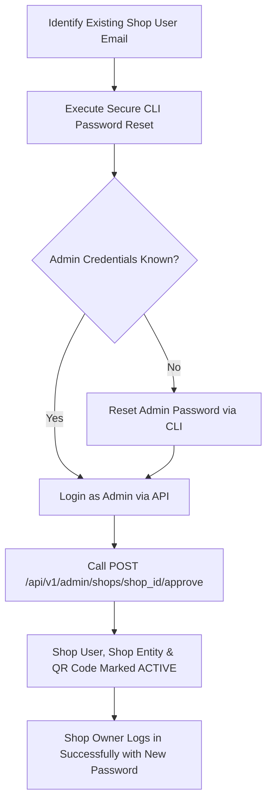

# SecurePrint Password Recovery Discovery & Architecture Report

**Document Date:** October 15, 2026  
**Status:** Discovery Complete & Non-Invasive Audit  
**Target Application:** SecurePrint FastAPI Backend (`app.main:app`)  
**Scope:** Authentication System, Identifier Resolution, Password Recovery, Admin Provisioning & Account Approval  

---

## 1. Executive Summary

This investigation analyzed the authentication, user management, and administrative infrastructure of the SecurePrint platform to resolve an account lockout issue on an existing shop account. The shop owner forgot their password, resulting in `400 Incorrect email or password` when attempting to log in via `POST /api/v1/auth/login`, and needs to access their existing account and complete the shop approval workflow.

### Compliance & Safety Guarantees
- **Zero Exposure:** No passwords, password hashes, secrets, environment keys, or JWT tokens are displayed or exposed in this report.
- **Zero Mutation:** No database records were altered, no passwords were reset, no new accounts were created, no roles were escalated, and no shops were approved during this audit.
- **Code Integrity:** All backend application files remain untouched.

---

## 2. Key Findings Matrix

| Inquiry / Task | Finding | Status / Detail |
|---|---|---|
| **Login Identifier Expected** | **Email Address** | The endpoint consumes standard `OAuth2PasswordRequestForm`. The form field `username` is strictly queried against `User.email`. Usernames, phone numbers, or shop names are rejected. |
| **Password Reset Endpoint** | **None Exists** | There are no routes for password reset, password recovery, forgot-password, or change-password. No email/SMTP infrastructure exists. |
| **Admin Provisioning Method** | **CLI Seeding Script** | Admin registration via API is hard-coded as disabled. Admins are provisioned via `seed_admin.py`, which is guarded and will not overwrite existing admin credentials. |
| **Documented Recovery Procedure** | **Ad-hoc Script Only** | No formal recovery docs exist in the repo. An ad-hoc maintenance script (`update_shop_pwd.py`) shows direct database password updates with Argon2id hashing have been used historically. |
| **Safe Recovery Path** | **Admin CLI Reset & Approval** | Direct credential update using `passlib.argon2` via an administrative script, followed by formal shop approval (`User`, `Shop`, and `ShopQrCode` status activation). |

---

## 3. Deep-Dive Findings

### 3.1. Authentication & User Management Architecture
- **Location:** [`backend/app/routes/auth.py`](file:///c:/Users/sansk/OneDrive/Desktop/SecurePrint/SecurePrint/backend/app/routes/auth.py)
- **Password Cryptography:** Passwords in the backend are hashed using **Argon2id** via `passlib.context.CryptContext(schemes=["argon2"], deprecated="auto")` defined in [`backend/app/core/security.py`](file:///c:/Users/sansk/OneDrive/Desktop/SecurePrint/SecurePrint/backend/app/core/security.py).
- **Session Tokens:** Tokens are signed JWT bearer tokens (`python-jose`) using HS256 and `SECRET_KEY`, with `sub` mapped to the user's email address.
- **Role Hierarchy:** Defined in [`backend/app/models/user.py`](file:///c:/Users/sansk/OneDrive/Desktop/SecurePrint/SecurePrint/backend/app/models/user.py):
  - `CUSTOMER`: Default role, auto-activated upon registration (`status = ACTIVE`).
  - `SHOP`: Shop vendor role, initialized in `PENDING` status upon registration with an associated `Shop`, pricing tiers (`ShopPricing`), and a revoked QR identity (`ShopQrCode.status = REVOKED`).
  - `ADMIN`: System administrator role.
- **Unique Constraints:** The `users` table enforces strict database-level unique constraints on both `email` and `phone`.

### 3.2. Exact Login Identifier Specification
- **Endpoint:** `POST /api/v1/auth/login`
- **Request Format:** `application/x-www-form-urlencoded` using FastAPI's standard `OAuth2PasswordRequestForm`.
- **Field Mapping:**
  ```python
  user = db.query(User).filter(User.email == form_data.username).first()
  if not user or not verify_password(form_data.password, user.password_hash):
      raise HTTPException(status_code=400, detail="Incorrect email or password")
  ```
- **Conclusion:** Even though the HTTP payload key is named `username` (per the OAuth2 specification), the backend logic exclusively queries `User.email`. 
- **Client Synchronization:** The desktop client in [`shop_desktop/lib/services/auth_service.dart`](file:///c:/Users/sansk/OneDrive/Desktop/SecurePrint/SecurePrint/shop_desktop/lib/services/auth_service.dart#L30-L33) correctly transmits `body: {'username': email, 'password': password}`. Supplying anything other than the account's registered email address will fail.

### 3.3. Status Check & Login Error Flow
The login route enforces a two-tier gate:
1. **Credential Validation (HTTP 400):** If `User.email` is not found or `verify_password` returns `False`, the backend immediately aborts with:
   ```json
   { "detail": "Incorrect email or password" }
   ```
2. **Account Status Gate (HTTP 403):** If credentials are valid, the backend verifies the user's lifecycle status:
   - `PENDING` &rarr; `403 Account pending approval`
   - `REJECTED` &rarr; `403 Account rejected`
   - `INACTIVE` &rarr; `403 Account inactive`

> [!IMPORTANT]
> Because a newly registered shop user is initially in `PENDING` status, recovering the password alone will result in `403 Account pending approval` unless the account is also approved by an administrator.

### 3.4. Account Recovery & Password Reset Assessment
A comprehensive inspection of `backend/app/routes/` confirmed:
- **No Self-Service Recovery:** There are no endpoints matching `/forgot-password`, `/reset-password`, `/recover`, or `/change-password`.
- **No Email Delivery Services:** There is no SMTP, SendGrid, Amazon SES, or email-sending subsystem configured in `app/core/config.py` or `.env`.
- **No In-Band Reset Tokens:** The system does not maintain reset tokens, OTPs, or recovery questions.

### 3.5. Administrator Provisioning & Current State
- **API Guard:** Line 23 of [`backend/app/routes/auth.py`](file:///c:/Users/sansk/OneDrive/Desktop/SecurePrint/SecurePrint/backend/app/routes/auth.py#L23) explicitly rejects administrative registration:
  ```python
  if user_in.role == UserRole.ADMIN:
      raise HTTPException(status_code=400, detail="Admin registration is disabled")
  ```
- **Seed Script (`seed_admin.py`):**
  - Admins are seeded via [`backend/seed_admin.py`](file:///c:/Users/sansk/OneDrive/Desktop/SecurePrint/SecurePrint/backend/seed_admin.py).
  - The script checks if an admin already exists:
    ```python
    admin_exists = db.query(User).filter(User.role == UserRole.ADMIN).first()
    if admin_exists:
        print("Admin user already exists.")
        return
    ```
  - An admin user (`admin@secureprint.com`) already exists in `secureprint.db`. Therefore, re-running `seed_admin.py` without modifying its logic will not reset or update admin credentials.
- **Approval Route (`admin.py`):**
  - Endpoint: `POST /api/v1/admin/shops/{shop_id}/approve`
  - Requires: Bearer token of a user with `role == UserRole.ADMIN`.
  - Atomically updates:
    1. `User.status = ACTIVE`
    2. `Shop.status = ACTIVE`
    3. `ShopQrCode.status = ACTIVE` (activates the shop's primary QR code)

---

## 4. Why Creating a Duplicate User Must Be Avoided

Attempting to register a new account to bypass the forgotten password is strongly contraindicated for the following architectural reasons:
1. **Unique Constraint Violation:** Both `User.email` and `User.phone` are marked `unique=True` in [`User`](file:///c:/Users/sansk/OneDrive/Desktop/SecurePrint/SecurePrint/backend/app/models/user.py#L22-L23) and validated in `POST /register`. Re-using the same email or phone number will fail with HTTP 400 (`Email already registered` or `Phone number already registered`).
2. **Orphaned Relational Data:** The existing user record already has configured records in `shops`, `shop_pricing` (8 pricing combinations), and `shop_qr_codes`. Registering a different email abandons these configured relationships.
3. **Database Pollution:** Creating throwaway accounts leads to orphaned records and multiple shops pointing to similar physical addresses.

---

## 5. Recommended Recovery Strategy

The safest, cleanest way to recover access to the existing shop account without risking data corruption, downtime, or security leaks involves a two-phase administrative operation:



### Phase 1: Secure Credential Reset
- Perform an administrative password reset using a standalone script that utilizes the existing `app.core.database.SessionLocal` and `app.core.security.get_password_hash`.
- **Security Requirement:** Use Python's standard `getpass` module so that the new password is typed interactively without being echoed to the terminal, saved in command history, or hardcoded in script files.

### Phase 2: Complete Shop Approval Workflow
- To avoid relational discrepancies where a user is `ACTIVE` but the shop entity or QR code remains `PENDING`/`REVOKED`:
  - **Preferred:** Authenticate as the administrator (`admin@secureprint.com`), obtain the admin JWT token, and invoke `POST /api/v1/admin/shops/{shop_id}/approve`.
  - **Alternative (Unified Script):** If invoking the HTTP API is inconvenient, execute a script that updates all three entities in a single atomic database transaction, matching lines 22–39 of [`backend/app/routes/admin.py`](file:///c:/Users/sansk/OneDrive/Desktop/SecurePrint/SecurePrint/backend/app/routes/admin.py#L22-L39).

---

## 6. Exact Next Steps Runbook (For Subsequent Implementation)

When authorized to proceed with recovery, the following non-disruptive steps should be executed:

### Step 1: Create an Administrative Recovery Script
Create a secure, non-interactive/interactive recovery utility at `backend/admin_recover_account.py`:
- Target the specific shop user by email.
- Prompt for the new password using `getpass.getpass()`.
- Hash the password with `get_password_hash()`.
- Update `user.password_hash`.
- Optionally update `user.status = ACTIVE`, `shop.status = ACTIVE`, and `shop_qr.status = ACTIVE` within the same transaction to complete approval immediately.

### Step 2: Execute the Script
Run the script using the backend virtual environment:
```powershell
cd C:\Users\sansk\OneDrive\Desktop\SecurePrint\SecurePrint\backend
.\venv\Scripts\python admin_recover_account.py
```

### Step 3: Verify Authentication via API
Test the login endpoint using PowerShell/curl:
```powershell
Invoke-RestMethod -Method Post `
  -Uri "http://127.0.0.1:8000/api/v1/auth/login" `
  -Headers @{ "Content-Type" = "application/x-www-form-urlencoded" } `
  -Body @{ username = "<shop_email>"; password = "<new_password>" }
```
Expected response: HTTP 200 containing `access_token`, `token_type: "bearer"`, and `role: "SHOP"`.

### Step 4: Log In via Flutter Desktop Application
Open the Flutter desktop application, enter the shop email and newly configured password, and verify smooth transition to the Shop Dashboard.
