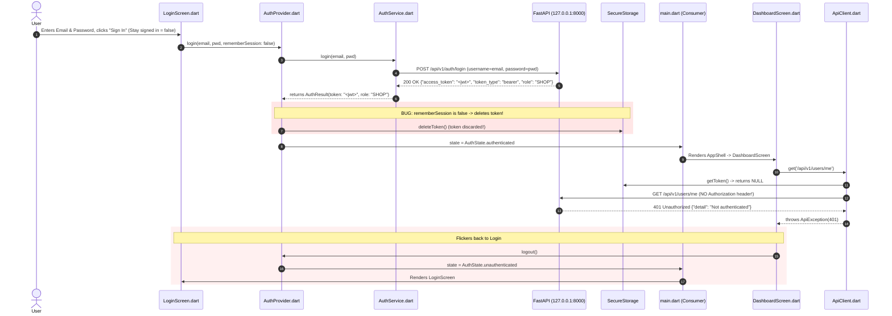

# SecurePrint Windows Shop App Login & Session Failure Diagnostic Report

**Document Date:** October 16, 2026  
**Status:** Diagnostic Investigation Complete (Code Unmodified)  
**Target Component:** Windows Shop Desktop Client (`shop_desktop/`) & FastAPI Backend (`backend/`)  
**Observed Phenomenon:** Shop account approved, backend running at `127.0.0.1:8000`. Login flickers and immediately returns to the Login Screen; backend logs show `GET /api/v1/users/me` returning `401 Unauthorized`.

---

## 1. Executive Summary

A non-invasive code and architectural trace was conducted to identify why the SecurePrint Windows Shop application flickers and bounces back to the Login Screen upon sign-in.

### Key Finding
**The login endpoint `POST /api/v1/auth/login` actually SUCCEEDS with HTTP 200.**  
However, immediately following successful login:
1. In [`shop_desktop/lib/providers/auth_provider.dart`](file:///c:/Users/sansk/OneDrive/Desktop/SecurePrint/SecurePrint/shop_desktop/lib/providers/auth_provider.dart#L118-L128), token persistence to `SecureStorage` was conditionally gated on the **"Stay signed in" (`rememberSession`)** checkbox.
2. In [`shop_desktop/lib/features/auth/login_screen.dart`](file:///c:/Users/sansk/OneDrive/Desktop/SecurePrint/SecurePrint/shop_desktop/lib/features/auth/login_screen.dart#L24), `_rememberSession` defaults to `false`.
3. Whenever a user logs in without manually checking "Stay signed in", line 125 executes:
   ```dart
   await _secureStorage.deleteToken();
   ```
   **The freshly issued JWT token is immediately purged from storage and discarded.**
4. Because [`ApiClient`](file:///c:/Users/sansk/OneDrive/Desktop/SecurePrint/SecurePrint/shop_desktop/lib/core/networking/api_client.dart#L58-L68) relies entirely on `await _secureStorage.getToken()` on every HTTP request and has no in-memory token fallback, it sends the subsequent `GET /api/v1/users/me` request **without an `Authorization` header**.
5. FastAPI's `OAuth2PasswordBearer` rejects the unauthenticated request with **`401 Unauthorized` (`detail: "Not authenticated"`)**.
6. [`DashboardScreen`](file:///c:/Users/sansk/OneDrive/Desktop/SecurePrint/SecurePrint/shop_desktop/lib/features/dashboard/dashboard_screen.dart#L36-L42) catches the 401 error as `DashboardState.unauthorized` and triggers `authProvider.logout()`, immediately flipping the UI back to `LoginScreen` and causing the visible screen flicker.

---

## 2. End-to-End Login Flow Trace



### Detailed Code Execution Path:

1. **User Submission:**  
   [`login_screen.dart:L89-L103`](file:///c:/Users/sansk/OneDrive/Desktop/SecurePrint/SecurePrint/shop_desktop/lib/features/auth/login_screen.dart#L89-L103)  
   User enters credentials and clicks **Sign In**. `_handleLogin()` forwards `rememberSession: _rememberSession` (which is `false` by default on line 24).
2. **Backend Authentication:**  
   [`auth_service.dart:L27-L35`](file:///c:/Users/sansk/OneDrive/Desktop/SecurePrint/SecurePrint/shop_desktop/lib/services/auth_service.dart#L27-L35)  
   Transmits form data to `POST http://127.0.0.1:8000/api/v1/auth/login`.  
   FastAPI verifies the shop credentials and returns HTTP 200 with JSON payload:
   `{"access_token": "...", "token_type": "bearer", "role": "SHOP"}`.
3. **Response Parsing:**  
   [`auth_service.dart:L36-L45`](file:///c:/Users/sansk/OneDrive/Desktop/SecurePrint/SecurePrint/shop_desktop/lib/services/auth_service.dart#L36-L45)  
   Parses `data['role']` (`'SHOP'`) and `data['access_token']`. Returns the token string.
4. **Flawed Storage Logic:**  
   [`auth_provider.dart:L118-L128`](file:///c:/Users/sansk/OneDrive/Desktop/SecurePrint/SecurePrint/shop_desktop/lib/providers/auth_provider.dart#L118-L128)  
   ```dart
   if (rememberSession) {
     await _secureStorage.saveToken(result.token);
     await _secureStorage.saveRememberSession(true);
     ...
   } else {
     await _secureStorage.deleteToken(); // <--- CRITICAL FLAW
     await _secureStorage.deleteRememberSession();
     await _secureStorage.deleteLocalUserData();
   }
   ```
   Because `rememberSession` is `false`, `deleteToken()` executes instead of `saveToken()`. The token is purged from storage.
5. **State Transition to Authenticated:**  
   [`auth_provider.dart:L130`](file:///c:/Users/sansk/OneDrive/Desktop/SecurePrint/SecurePrint/shop_desktop/lib/providers/auth_provider.dart#L130)  
   Sets `_state = AuthState.authenticated; notifyListeners();`.
6. **Navigation Swap:**  
   [`main.dart:L92-L95`](file:///c:/Users/sansk/OneDrive/Desktop/SecurePrint/SecurePrint/shop_desktop/lib/main.dart#L92-L95)  
   `Consumer<AuthProvider>` sees `auth.isAuthenticated == true` and mounts `AppShell` with [`DashboardScreen`](file:///c:/Users/sansk/OneDrive/Desktop/SecurePrint/SecurePrint/shop_desktop/lib/features/dashboard/dashboard_screen.dart).
7. **Profile Request:**  
   [`dashboard_screen.dart:L19-L25`](file:///c:/Users/sansk/OneDrive/Desktop/SecurePrint/SecurePrint/shop_desktop/lib/features/dashboard/dashboard_screen.dart#L19-L25) & [`dashboard_provider.dart:L69`](file:///c:/Users/sansk/OneDrive/Desktop/SecurePrint/SecurePrint/shop_desktop/lib/providers/dashboard_provider.dart#L69)  
   In `initState()`, `DashboardScreen` invokes `loadDashboard()`, which calls `_shopService.getShopProfile()` &rarr; `ApiClient.get('/api/v1/users/me')`.
8. **Missing Authorization Header:**  
   [`api_client.dart:L58-L68`](file:///c:/Users/sansk/OneDrive/Desktop/SecurePrint/SecurePrint/shop_desktop/lib/core/networking/api_client.dart#L58-L68)  
   `ApiClient` calls `await _secureStorage.getToken()`. Since `deleteToken()` was called, `token` is `null`. No `Authorization` header is attached.
9. **FastAPI 401 Response:**  
   FastAPI ([`backend/app/routes/users.py:L12-L14`](file:///c:/Users/sansk/OneDrive/Desktop/SecurePrint/SecurePrint/backend/app/routes/users.py#L12-L14)) enforces `OAuth2PasswordBearer`. Missing Authorization header immediately returns:
   `HTTP 401 Unauthorized` (`{"detail": "Not authenticated"}`).
10. **The Logout Bounce (Flicker):**  
    [`dashboard_screen.dart:L36-L42`](file:///c:/Users/sansk/OneDrive/Desktop/SecurePrint/SecurePrint/shop_desktop/lib/features/dashboard/dashboard_screen.dart#L36-L42)  
    `DashboardProvider` enters `DashboardState.unauthorized`. `DashboardScreen` catches this and calls `context.read<AuthProvider>().logout()`, which resets `_state = AuthState.unauthenticated`. `main.dart` replaces `AppShell` with `LoginScreen`.

---

## 3. Evaluation of Specific Inquiries

### Task 2: Did Login Succeed Before `/users/me` Failed?
- **CONFIRMED:** Yes.
- **Evidence:**  
  1. The endpoint `GET /api/v1/users/me` is **only ever invoked** inside `DashboardProvider.loadDashboard()` ([`shop_service.dart:L15`](file:///c:/Users/sansk/OneDrive/Desktop/SecurePrint/SecurePrint/shop_desktop/lib/services/shop_service.dart#L15)), which only mounts when `auth.isAuthenticated` is true.
  2. If `POST /api/v1/auth/login` had returned `400` or `403`, `AuthService.login` would throw an `AuthServiceException`. `AuthProvider` would catch it, set `_errorMessage`, and keep `_state = AuthState.unauthenticated`. The app would remain on the Login Screen with an error banner, and `GET /api/v1/users/me` would **never be called**.
  3. The presence of `GET /api/v1/users/me` in the backend log proves conclusively that `POST /api/v1/auth/login` succeeded and triggered navigation into `AppShell`.

### Task 3: Token Field Name Verification
- **CONFIRMED MATCH:**
  - Backend response model ([`backend/app/schemas/user.py:L66-L69`](file:///c:/Users/sansk/OneDrive/Desktop/SecurePrint/SecurePrint/backend/app/schemas/user.py#L66-L69)):
    - `access_token`: `str`
    - `token_type`: `str` (value `"bearer"`)
    - `role`: `UserRole`
  - Flutter parsing ([`shop_desktop/lib/services/auth_service.dart:L37-L45`](file:///c:/Users/sansk/OneDrive/Desktop/SecurePrint/SecurePrint/shop_desktop/lib/services/auth_service.dart#L37-L45)):
    - Reads `data['role']` &rarr; verified as `'SHOP'`
    - Reads `data['access_token']` &rarr; correctly extracted into `token`
  - The JSON key `access_token` matches exactly.

### Task 4: Authorization Header & Storage Key Alignment
- **Storage Key:** [`shop_desktop/lib/services/secure_storage.dart:L5`](file:///c:/Users/sansk/OneDrive/Desktop/SecurePrint/SecurePrint/shop_desktop/lib/services/secure_storage.dart#L5)  
  `static const _tokenKey = 'secureprint_shop_auth_token';`  
  Both `saveToken()` and `getToken()` access the exact same constant key.
- **Header Injection:** [`shop_desktop/lib/core/networking/api_client.dart:L64-L66`](file:///c:/Users/sansk/OneDrive/Desktop/SecurePrint/SecurePrint/shop_desktop/lib/core/networking/api_client.dart#L64-L66)  
  `headers['Authorization'] = 'Bearer $token';`  
  Matches FastAPI's expected `OAuth2PasswordBearer` scheme (`Bearer <jwt>`).
- **Failure Cause:** `token` is `null` at request time because `AuthProvider.login()` deleted it when `rememberSession == false`.

### Task 5: Saved App Settings & Stale Session State (Startup Scenario)
- **File Detected on Disk:**  
  `C:\Users\sansk\AppData\Roaming\SecurePrint\SecurePrint Shop\flutter_secure_storage.dat` (294 bytes, DPAPI-encrypted).
- **Secondary Root Cause on App Startup:**  
  In [`shop_desktop/lib/providers/auth_provider.dart:L66-L86`](file:///c:/Users/sansk/OneDrive/Desktop/SecurePrint/SecurePrint/shop_desktop/lib/providers/auth_provider.dart#L66-L86):
  ```dart
  Future<void> _initialize() async {
    final token = await _secureStorage.getToken();
    if (token != null) {
      ...
      _state = AuthState.authenticated;
    }
  ```
  1. `_initialize()` unconditionally sets `_state = AuthState.authenticated` if any token exists in storage.
  2. It does **not** check whether `rememberSession` was true, nor does it test the token's validity before declaring authentication.
  3. The backend configuration ([`backend/.env:L4`](file:///c:/Users/sansk/OneDrive/Desktop/SecurePrint/SecurePrint/backend/.env#L4)) enforces `ACCESS_TOKEN_EXPIRE_MINUTES=15`.
  4. Any token stored longer than 15 minutes is expired. On launch, the app assumes it is logged in, mounts `DashboardScreen`, sends the expired token to `/api/v1/users/me`, receives `401 Unauthorized` (`detail: "Could not validate credentials"`), and immediately logs out back to `LoginScreen`.

---

## 4. Root Cause Breakdown: Confirmed vs. Hypotheses

| Factor | Classification | Evidence & Impact |
|---|---|---|
| **`rememberSession: false` purges active token** | **CONFIRMED PRIMARY CAUSE** | In [`auth_provider.dart:L124`](file:///c:/Users/sansk/OneDrive/Desktop/SecurePrint/SecurePrint/shop_desktop/lib/providers/auth_provider.dart#L124), `deleteToken()` is called when `rememberSession == false`. `login_screen.dart:L24` defaults this to `false`. Without a stored token, `ApiClient._buildHeaders()` attaches no Authorization header, causing `401 Unauthorized` on `/api/v1/users/me` on every standard login attempt. |
| **Dashboard unauthorized auto-logout trigger** | **CONFIRMED MECHANISM** | [`dashboard_screen.dart:L36-L42`](file:///c:/Users/sansk/OneDrive/Desktop/SecurePrint/SecurePrint/shop_desktop/lib/features/dashboard/dashboard_screen.dart#L36-L42) catches 401 via `DashboardState.unauthorized` and calls `authProvider.logout()`, generating the observed UI flicker. |
| **Startup stale session expiry** | **CONFIRMED SECONDARY CAUSE** | [`auth_provider.dart:L67`](file:///c:/Users/sansk/OneDrive/Desktop/SecurePrint/SecurePrint/shop_desktop/lib/providers/auth_provider.dart#L67) blindly accepts any existing token on startup without validation. If the token is older than 15 minutes, the app launches, attempts `/users/me`, receives 401, and flickers back to login. |
| **Token field name mismatch** | **DISPROVED HYPOTHESIS** | `access_token` in FastAPI exactly matches `data['access_token']` in Dart. |
| **Authorization scheme mismatch** | **DISPROVED HYPOTHESIS** | `Bearer <token>` in `api_client.dart` matches FastAPI `OAuth2PasswordBearer`. |
| **Backend crash or CORS failure** | **DISPROVED HYPOTHESIS** | Backend is actively running on port 8000 and correctly responding with HTTP status codes. |

---

## 5. Smallest Targeted Fix (Recommended Next Steps)

When authorized to apply code modifications, the smallest, cleanest, and most robust fix requires updates to two files in `shop_desktop`:

### Fix 1: Always Persist Token for the Active Session in `AuthProvider`
In [`shop_desktop/lib/providers/auth_provider.dart`](file:///c:/Users/sansk/OneDrive/Desktop/SecurePrint/SecurePrint/shop_desktop/lib/providers/auth_provider.dart#L118-L128):
An active session **must always have an access token** in `_secureStorage` so that `ApiClient` can authenticate HTTP calls. The `rememberSession` flag should only control persistence across application restarts:

```dart
// ALWAYS save active token so ApiClient has it for the current session
await _secureStorage.saveToken(result.token);
await _secureStorage.saveRememberSession(rememberSession);

if (rememberSession) {
  if (result.isLocal && result.user != null) {
    await _secureStorage.saveLocalUserData(jsonEncode(result.user!.toJson()));
  }
} else {
  // If not remembering across restarts, ensure local account caches are cleared
  await _secureStorage.deleteLocalUserData();
}
```

### Fix 2: Check `getRememberSession()` on Startup in `AuthProvider`
In [`shop_desktop/lib/providers/auth_provider.dart`](file:///c:/Users/sansk/OneDrive/Desktop/SecurePrint/SecurePrint/shop_desktop/lib/providers/auth_provider.dart#L66-L86):
Only restore the session if the user explicitly opted into "Stay signed in":

```dart
Future<void> _initialize() async {
  final shouldRemember = await _secureStorage.getRememberSession();
  if (!shouldRemember) {
    await _secureStorage.deleteToken();
    _state = AuthState.unauthenticated;
    notifyListeners();
    return;
  }

  final token = await _secureStorage.getToken();
  if (token != null) {
    ...
```

### Fix 3 (Optional UX Polish): Default "Stay Signed In" to Checked
In [`shop_desktop/lib/features/auth/login_screen.dart:L24`](file:///c:/Users/sansk/OneDrive/Desktop/SecurePrint/SecurePrint/shop_desktop/lib/features/auth/login_screen.dart#L24):
```dart
bool _rememberSession = true;
```
Ensuring desktop shop operators remain signed in across work sessions by default.
